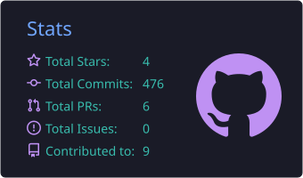
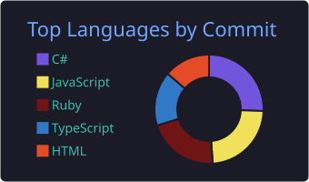
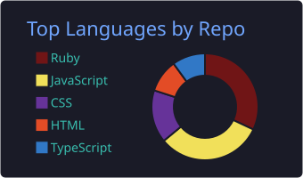
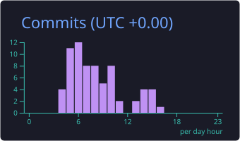

<!-- HEADER BANNER -->
<div align="center">
  

  <a href="https://github.com/beingamit4197">
    
  </a>

  <p>
    
    
    
  </p>

  <p>
    <a href="https://www.linkedin.com/in/beingamit4197"></a>
    <a href="mailto:beingamit4197@gmail.com"></a>
    <a href="https://x.com/ammiii___"></a>
  </p>
</div>

---

## 👨‍💻 About Me

```ts
const amit = {
  role: "Software Engineer @ Code Avenue Pvt. Ltd.",
  location: "Lucknow, Uttar Pradesh, India 🇮🇳",
  currentlyBuilding: "Shoppio (eCommerce)",
  currentlyLearning: ["React Native", "System Design"],
  askMeAbout: ["React", "Ruby on Rails", "TypeScript", "UI Engineering"],
  funFact: "I turn coffee into pull requests ☕",
};
```

- 🔭 Working on **[Shoppio (eCommerce)](https://github.com/beingamit4197)**
- 🌱 Learning **React Native**
- 💬 Ask me about **React, Ruby on Rails, TypeScript**
- 📫 Reach me at **[beingamit4197@gmail.com](mailto:beingamit4197@gmail.com)**

---

## 🛠️ Tech Stack

<div align="center">

**Frontend**


**Backend & Database**


**Tools**


</div>

---

## 📊 GitHub Stats

<div align="center">
  
</div>

<div align="center">
  
  
</div>

<div align="center">
  
  
</div>

---

## 🐍 Contribution Snake

<!-- Needs a GitHub Action (Platane/snk) in your profile repo; see setup notes below -->
<div align="center">
  <picture>
    <source media="(prefers-color-scheme: dark)" srcset="https://raw.githubusercontent.com/beingamit4197/beingamit4197/output/github-contribution-grid-snake-dark.svg" />
    <source media="(prefers-color-scheme: light)" srcset="https://raw.githubusercontent.com/beingamit4197/beingamit4197/output/github-contribution-grid-snake.svg" />
    
  </picture>
</div>

---

<div align="center">
  <i>"Make it work, make it right, make it fast."</i> ⚡
  <br /><br />
  
</div>
